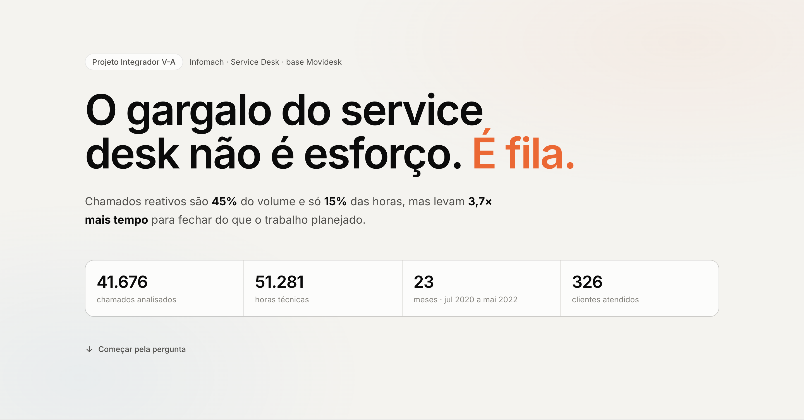

# Service Desk Analytics — Infomach

**O gargalo do service desk não é esforço. É fila.**

Painel analítico interativo sobre a base de atendimento (Movidesk) da **Infomach**, um provedor de serviços gerenciados de TI e Segurança (MSSP) de Goiânia/GO. O projeto foi desenvolvido como **Projeto Integrador V-A** do curso de Big Data e Inteligência Artificial da **PUC Goiás (CEAD)**, em parceria extensionista com a empresa.



## O que o painel responde

| Pergunta da coordenação técnica | Decisão apoiada | Achado |
|---|---|---|
| A demanda cresce? O esforço acompanha? | Dimensionamento das equipes | Chamados **+66%**, horas **+19%** |
| Quanto é reativo e onde ele trava? | Onde atacar primeiro | Reativo = **45%** dos chamados, **15%** das horas, **3,7×** mais tempo para fechar; o Backup concentra **48%** do reativo |
| A prioridade muda o tempo de atendimento? | Régua de prioridade / SLA | “Alta” (22 h) ≈ “Normal” (23 h) |
| Para onde vão as horas? | Contratos e alocação | **21%** das horas são internas; **8%** dos clientes consomem **50%** das horas externas |

## Como funciona

```
Movidesk (CSV) ──► Python / pandas ──► JSON anonimizado ──► React + Recharts (navegador)
                   src/prepare_data.py   src/export_web_data.py   web/
```

- **Python** limpa a base, unifica equipes, cria o tipo de demanda e o tempo de ciclo, e exporta um JSON colunar sem nenhum dado pessoal (sem texto livre, nomes ou e-mails).
- **Front-end** (Vite + React + TypeScript + Recharts + Tailwind) recalcula os nove KPIs no próprio navegador a cada filtro. As fórmulas de `src/kpis.py` e `web/src/lib/data.ts` são as mesmas.
- **Data storytelling:** página única com capítulos (tese → problema → três conflitos → recomendações). Os textos de “Achado” são calculados e mudam com os filtros.
- **Boas práticas de visualização:** cor com função (laranja só para o problema), sem eixo duplo, títulos-conclusão, paleta validada para daltonismo, modo escuro com tons próprios, tabela de dados em cada gráfico e layout responsivo.

## Estrutura

```
src/
  prepare_data.py      CSV do Movidesk -> data/processed/tickets.parquet (1 linha = 1 chamado)
  kpis.py              definição dos KPIs e da janela de análise
  export_web_data.py   parquet -> web/public/data/tickets.json
web/                   painel (Vite + React + TypeScript)
  src/lib/data.ts      filtros, KPIs e agregações (espelho de kpis.py)
  src/components/      gráficos e componentes de interface
scripts/
  capture_figures.py   captura as figuras do painel (claro/escuro) para relatório e slides
  build_report.py      gera o relatório técnico (.docx) a partir de docs/relatorio.md
  build_slides.py      gera a apresentação (.pptx)
docs/
  relatorio.md         texto do relatório técnico
  roteiro_video.md     roteiro da apresentação em vídeo
  figuras/             capturas do painel
```

## Como ver o painel

Requer **Node.js 20+**. Os dados anonimizados do painel já estão no repositório (`web/public/data/tickets.json`).

```bash
cd web
npm install
npm run dev        # abra http://localhost:5173
```

Para gerar o site estático: `npm run build` (saída em `web/dist/`).

## Como regenerar os dados (opcional)

Requer o CSV original cedido pela Infomach em `data/raw/tickets-ml-mask.csv`, que não é distribuído.

```bash
python -m venv .venv && source .venv/bin/activate
pip install -r requirements.txt
python src/prepare_data.py       # CSV -> data/processed/tickets.parquet
python src/export_web_data.py    # parquet -> web/public/data/tickets.json
```

Para gerar os entregáveis: `playwright install chromium`, depois rode `python scripts/capture_figures.py` (com o painel rodando), `python scripts/build_report.py` e `python scripts/build_slides.py`.

## Dados

A base original do Movidesk é **confidencial e não é distribuída** neste repositório. Ela foi cedida pela Infomach de forma **anonimizada** (clientes e técnicos mascarados), exclusivamente para fins acadêmicos.

O único arquivo de dados versionado é `web/public/data/tickets.json`, gerado pelo pipeline: 1 linha por chamado, apenas com campos categóricos e numéricos (mês, equipe, prioridade, categoria, serviço, cliente e técnico mascarados, horas, ciclo). Não há texto livre, nomes ou e-mails de pessoas.

## Autor

Alcebiades Alves Barbosa Filho · Projeto Integrador V-A · Big Data e Inteligência Artificial · PUC Goiás, 2026
